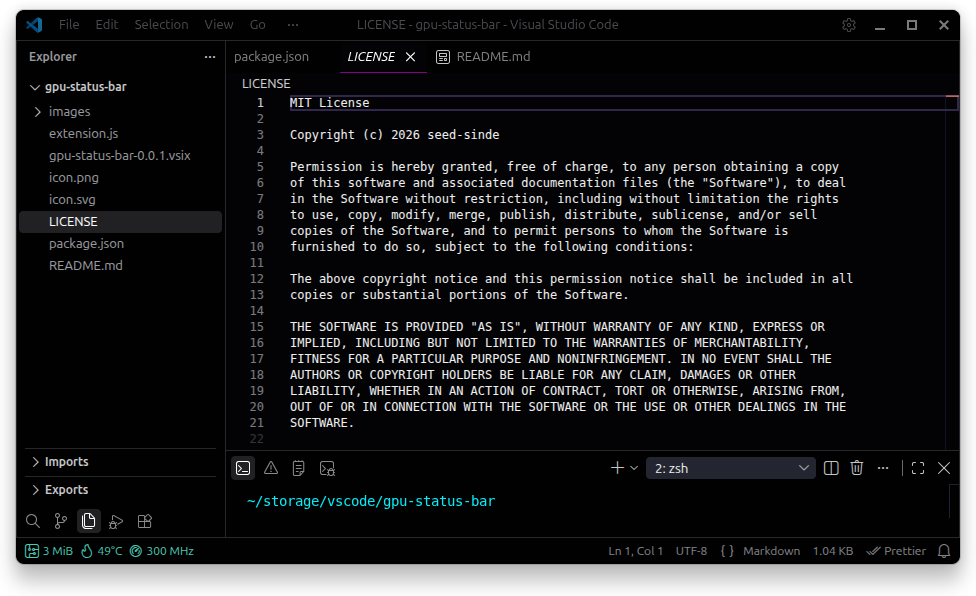

# GPU Status Bar

Lightweight VS Code extension that shows real-time NVIDIA GPU information directly in the status bar.

## Features

- **Memory usage** — current VRAM consumption in MiB
- **Temperature** — GPU temperature with color indication:
  - Green — normal
  - Yellow — warm (> 70°C)
  - Red — hot (> 80°C)
- **Frequency** — current SM clock speed in MHz
- Updates automatically every 2 seconds (configurable)
- Works on the left or right side of the status bar

## Requirements

- NVIDIA GPU
- `nvidia-smi` available in system PATH

## Extension Settings

| Setting                       | Default | Description                     |
| ----------------------------- | ------- | ------------------------------- |
| `gpuStatusBar.updateInterval` | `2000`  | Update interval in milliseconds |

## How it looks

_Real-time GPU memory, temperature and frequency in the status bar_

## Installation

1. Download the `.vsix` file
2. In VS Code: `Ctrl+Shift+P` → **Extensions: Install from VSIX...**
3. Select the file and reload the window

## License

MIT
